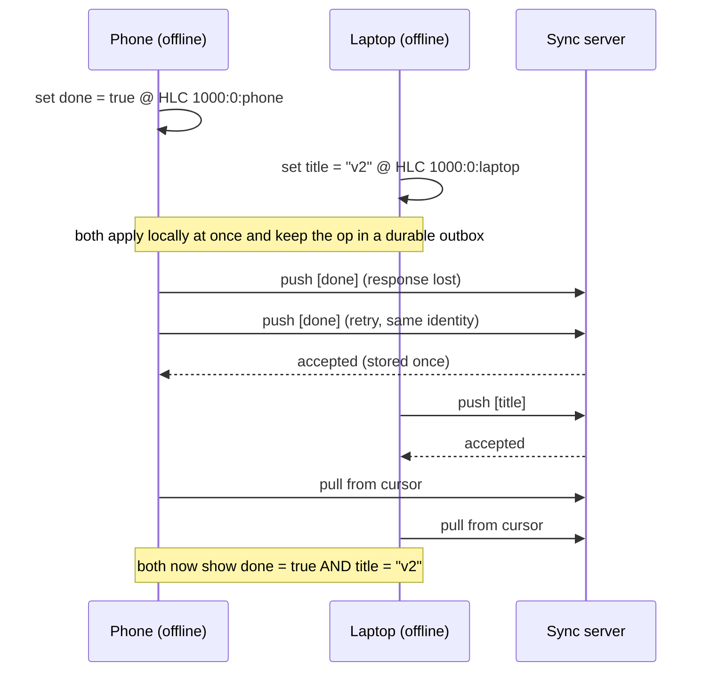

# offline-first-sync-engine

**Your users edit offline on two devices. When they reconnect, whose edit wins, and what gets lost?**

This TypeScript engine lets web and mobile apps work fully offline and merge cleanly when they
reconnect. Concurrent edits to different fields of a record both survive. Conflicts on the same field
resolve the same way on every device. A flaky network cannot lose or duplicate a write.
Zero runtime dependencies.

[](../../actions/workflows/ci.yml)


## The problem with "last write wins"

Most offline sync code saves whole records and keeps the one with the newest device time. That
fails in three ordinary situations:

1. The phone marks a task **done**, and the laptop renames it. The second save overwrites the first, so the task is suddenly not done.
2. A device clock is ten minutes fast. That device wins every conflict until someone notices.
3. The response to a save is lost and the app retries. The server now has the change twice.

## How this engine handles it



| Mechanism | What it buys you |
|---|---|
| **Field-level operations** | Edits to different fields never overwrite each other |
| **Hybrid logical clocks** | Stays close to real time. Never runs backwards, even if the device clock does. Always moves past what it has seen. Timestamps more than 5 minutes in the future are rejected. |
| **Timestamp = operation identity** | Retries and duplicated requests are stored once. Reusing an identity with different content is rejected. A client cannot stamp another client's operations. |
| **Confirmed state + durable outbox** | The UI works offline. An operation the server rejects simply disappears, with no manual rollback. |
| **Numbered server log + cursor** | Cheap incremental pulls. The log can be compacted, and devices far behind get a snapshot. |
| **Tombstones with timestamps** | A delete hides older fields. An edit made offline *after* the delete is not lost. |

The merge function is commutative, associative and idempotent: a state-based CRDT. The design and
its limits are in [ADR-0001](docs/adr-0001-field-level-lww-with-hlc.md).

## Tested against a hostile network

`test/convergence.test.ts` simulates three devices with clocks up to ±10 s wrong. The script runs
150 random steps per seed: field writes, deletes, app restarts from storage, log compaction, and
syncs through a transport that randomly loses requests, loses responses, duplicates calls and goes
offline. At the end every device must match the server exactly, with an empty outbox and no
operation stored twice. CI runs 200 seeds on Node 22 and 24. The suite was checked by mutation: removing the server's
dedupe or the tombstone ordering makes it fail.

| Scenario | Test |
|---|---|
| Different fields edited offline on two devices: both kept | `offline edits to different fields of one record both survive` |
| Response lost, client retries: stored once | `a lost acknowledgement does not create duplicates` |
| App restart; device clock moved backwards | `state, outbox and clock survive a restart` |
| Server rejects an operation (authorization) | `an operation the server rejects disappears from the local view` |
| Device far behind the compacted log | `a client behind the compaction horizon resyncs from a snapshot…` |
| Forged identity, clock in the future, oversized, `__proto__` fields | `server.test.ts` |
| Randomized convergence under faults | `devices converge under lost, duplicated and refused messages` |

## Use it

```ts
import { SyncClient, MemoryStorage, type Transport } from "offline-first-sync-engine";

const transport: Transport = {
  push: (req) => fetch("/sync/push", { method: "POST", body: JSON.stringify(req) }).then(ok),
  pull: (req) => fetch("/sync/pull", { method: "POST", body: JSON.stringify(req) }).then(ok),
};
// ok() should throw TransportError for network errors and 5xx, so they are retried with backoff.

const client = await SyncClient.open({ clientId: deviceId, transport, storage: new MemoryStorage() });
await client.set("tasks", "t1", { title: "Prepare board pack", done: false });
client.get("tasks", "t1");          // works offline
await client.sync();                // push outbox, pull until up to date
```

Install from GitHub: `npm i github:md-rubbaite/offline-first-sync-engine#v1.0.0`.

```bash
npm ci
npm test       # 68 tests, 40 random seeds by default (SYNC_SEEDS=200 for more)
npm run demo   # two devices edit offline, then reconcile over a flaky network
```

## Production checklist

- [ ] **Storage:** implement `Storage` on IndexedDB (one transaction per `save`), SQLite or the platform store. `save` must be atomic.
- [ ] **Server:** back `SyncServer` with [docs/postgres-schema.sql](docs/postgres-schema.sql) and process each push batch in one transaction. Read the sequence-gap caveat in that file.
- [ ] **Identity:** derive `clientId` from the authenticated device or session, never from the request body.
- [ ] **Authorization:** plug per-collection and per-document rules into the `authorize` hook.
- [ ] **Compaction:** compact the log once every active device has pulled past a point. Snapshots cover devices that come back later.
- [ ] **Monitoring:** alert on outbox age per device, rejected-operation rate and clock-drift rejections.
- [ ] **Invariants:** use server-validated commands (not field writes) for rules such as stock never going below zero.
- [ ] **Collaborative text:** keep a sequence CRDT for that one field; this engine resolves same-field edits by last writer.

## Layout

```
src/hlc.ts        hybrid logical clock, sortable string encoding
src/replica.ts    field-level LWW CRDT with tombstones
src/client.ts     offline-first client: outbox, confirmed state, sync loop
src/server.ts     reference server: validation, dedupe, numbered log, compaction
src/retry.ts      exponential backoff with full jitter
src/testing.ts    in-process and fault-injecting transports
docs/             ADR, PostgreSQL schema
```

## Author

Built by **Rubbaite T. Hassain**, Software Architect and founder of
[Datazo InfoTech](https://www.datazoinfotech.com.bd). We build offline-capable fintech and
healthcare systems. Get in touch if you need this taken to production.

Architecture, requirements and review by Rubbaite T. Hassain; implementation AI-assisted.

MIT licensed.
